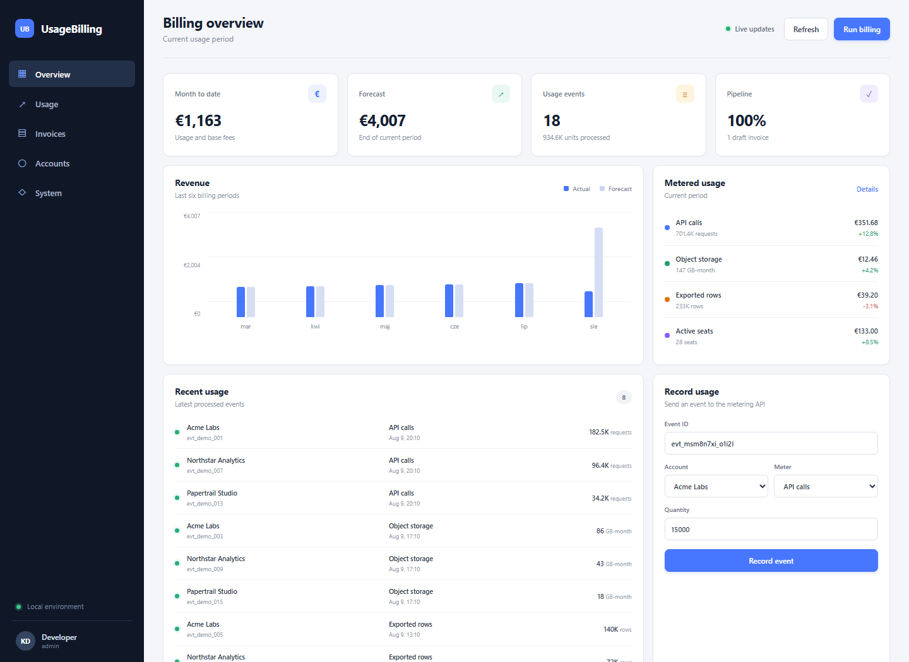
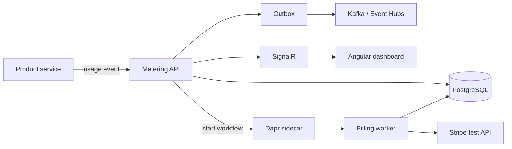

# UsageBilling

UsageBilling collects product usage events and turns them into monthly invoices. Each event has an idempotency key, an account, a meter and a quantity. The current implementation includes tiered pricing, monthly aggregation, an Outbox publisher, invoice state changes and a Dapr workflow for running the billing process.



## Included

- metering API with idempotent event ingestion
- sum and maximum aggregations
- included usage, first-tier and overage pricing
- monthly usage aggregates and invoice lines
- transactional Outbox with Kafka publishing and retry
- Kafka-compatible Azure Event Hubs configuration
- Dapr Workflow with retry policy for invoice calculation and issue
- PostgreSQL with EF Core migrations
- Redis cache for the overview
- Stripe test adapter; demo mode is used when no key is configured
- Angular dashboard with SignalR updates
- OpenTelemetry traces and metrics, Prometheus, Tempo and Grafana
- .NET Aspire AppHost and Docker Compose
- Terraform for Azure Container Apps, PostgreSQL, Redis, Event Hubs, ACR and Key Vault

## Flow



A usage event and its Outbox message are saved before publishing. If Kafka is unavailable, the event is still accepted and the background publisher retries the pending message. Duplicate event IDs return a successful response without changing the aggregate twice.

The billing workflow calls separate activities for creating and issuing an invoice. Activities are idempotent: generating an invoice for the same account and period returns the existing invoice.

## Run without containers

Requirements: .NET 10 SDK, Node.js 24 and pnpm 11.

Start the API:

```powershell
dotnet run --project src/UsageBilling.Api
```

Start the dashboard in a second terminal:

```powershell
cd frontend
pnpm install
pnpm start
```

Open `http://localhost:4200`. The API runs on `http://localhost:5090` and starts with an in-memory database and sample data. OpenAPI JSON is available at `http://localhost:5090/openapi/v1.json`.

## Run the complete stack

```powershell
docker compose up --build
```

The compose stack starts:

| Service | Address |
|---|---|
| Dashboard | `http://localhost:4200` |
| API | `http://localhost:5090` |
| Grafana | `http://localhost:3000` |
| Prometheus | `http://localhost:9090` |
| Tempo | `http://localhost:3200` |
| Kafka | `localhost:9092` |
| PostgreSQL | `localhost:5432` |
| Redis | `localhost:6379` |

Grafana accepts anonymous viewer access. The local admin credentials are `admin` / `admin` if configuration changes are needed.

The same dependencies can be started from the Aspire dashboard:

```powershell
dotnet run --project src/UsageBilling.AppHost
```

Aspire requires Docker. The Dapr CLI must be installed and initialized before starting the AppHost because the worker is attached to a Dapr sidecar.

## Send usage

```powershell
$body = @{
  eventId = "evt_20260809_001"
  accountId = "acme-labs"
  meter = "api_calls"
  quantity = 25000
  occurredAt = "2026-08-09T12:30:00Z"
  dimensions = @{ region = "eu"; endpoint = "/exports" }
} | ConvertTo-Json

Invoke-RestMethod `
  -Method Post `
  -Uri http://localhost:5090/api/usage-events `
  -ContentType application/json `
  -Body $body
```

Sending the same `eventId` again returns `duplicate: true` and does not add another 25,000 calls.

## Billing endpoints

| Method | Path | Purpose |
|---|---|---|
| `GET` | `/api/overview` | current totals and recent activity |
| `GET` | `/api/accounts` | billing accounts and current charges |
| `GET` | `/api/meters` | meter definitions and price tiers |
| `GET` | `/api/usage-events` | received usage events |
| `GET` | `/api/usage-aggregates` | monthly aggregates and calculated charges |
| `GET` | `/api/invoices` | invoices with line items |
| `GET` | `/api/outbox` | Outbox delivery state |
| `POST` | `/api/usage-events` | record product usage |
| `POST` | `/api/billing-runs` | calculate an invoice directly |
| `POST` | `/api/billing-workflows` | schedule the Dapr billing workflow |
| `POST` | `/api/invoices/{id}/issue` | issue a draft through the payment adapter |
| `POST` | `/api/invoices/{id}/paid` | mark an open invoice as paid |

`/api/billing-runs` is useful when running only the API. `/api/billing-workflows` requires the Dapr sidecar and runs the same calculation as a durable workflow.

## Configuration

The default configuration does not contact external services.

| Setting | Local default | Other value |
|---|---|---|
| `Storage__Provider` | `InMemory` | `Postgres` |
| `Storage__ConnectionString` | local PostgreSQL string | managed PostgreSQL connection |
| `Redis__Enabled` | `false` | `true` |
| `Messaging__Provider` | `Demo` | `Kafka` or `EventHubs` |
| `Messaging__BootstrapServers` | `localhost:9092` | Event Hubs Kafka endpoint on port 9093 |
| `Stripe__Mode` | `Demo` | `Test` |
| `Stripe__SecretKey` | empty | a key beginning with `sk_test_` |
| `OTEL_EXPORTER_OTLP_ENDPOINT` | empty | OTLP gRPC collector address |

For Azure Event Hubs, set `Messaging__SaslUsername` to `$ConnectionString` and put the namespace connection string in `Messaging__SaslPassword`.

The Stripe adapter deliberately accepts test keys only. In demo mode it returns a local invoice ID and makes no network request.

## Database migrations

```powershell
dotnet tool restore
dotnet tool run dotnet-ef database update `
  --project src/UsageBilling.Infrastructure `
  --startup-project src/UsageBilling.Api
```

The API applies pending migrations on startup when PostgreSQL is selected. Sample accounts, meters, events and historical invoices are inserted only when the database is empty.

## Tests

```powershell
dotnet test UsageBilling.sln
cd frontend
pnpm run build
terraform -chdir=infra/terraform init -backend=false
terraform -chdir=infra/terraform validate
```

The test projects cover price tiers, invoice state changes, seeded dashboard data, event idempotency, validation and invoice generation through the HTTP API.

## Azure

The Terraform configuration is in `infra/terraform`.

```powershell
terraform -chdir=infra/terraform init
terraform -chdir=infra/terraform plan `
  -var="database_password=<password>" `
  -var="api_image=<registry>/usage-billing-api:<tag>" `
  -var="worker_image=<registry>/usage-billing-worker:<tag>" `
  -var="web_image=<registry>/usage-billing-web:<tag>"
```

It creates an internal API, a Dapr-enabled billing worker and an external web app in one Container Apps environment. Event Hubs is exposed through its Kafka-compatible endpoint, so the application publisher does not change between local Kafka and Azure.